<p align="center">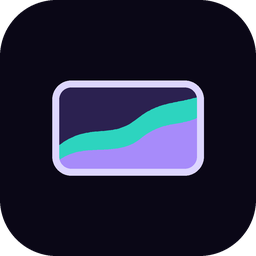</p>

<h1 align="center">DeskDeck</h1>

<p align="center"><b>Give that old Android phone a second life as a glass dashboard for your computer.</b><br>
Live PC stats, AI coding quotas, music and one-tap shortcuts, over USB or plain Wi-Fi.<br>
Windows · Linux · macOS. No root, no account, no cloud.</p>

<p align="center">
  <a href="https://anirudhkaplish.github.io/deskdeck/"><b>▶ Try it in your browser</b></a> ·
  <a href="https://github.com/AnirudhKaplish/deskdeck/releases/latest"><b>Download</b></a> ·
  <a href="#get-started"><b>Get started</b></a>
</p>

<p align="center">
  <a href="https://github.com/AnirudhKaplish/deskdeck/releases/latest"></a>
  
  
  <a href="LICENSE"></a>
</p>

<p align="center">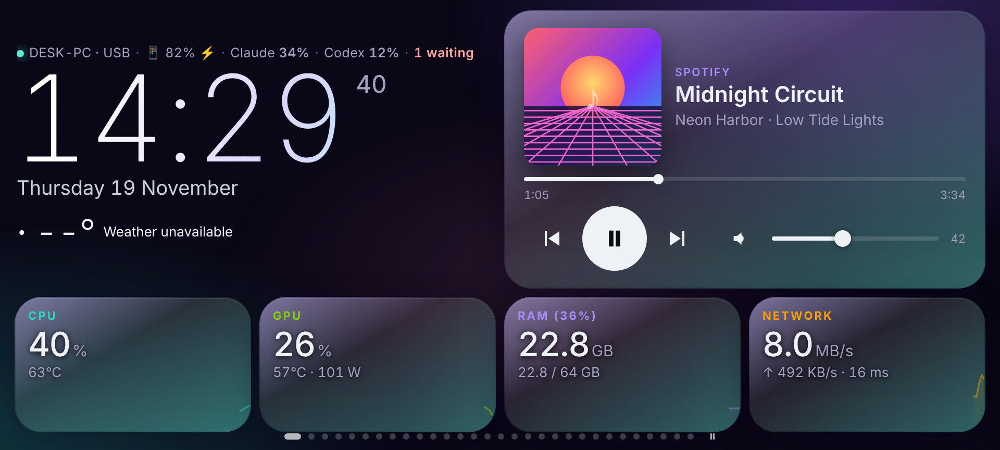<br>
<sub>The default Aurora glass theme, with demo data.</sub></p>

## What it is

Two small pieces that talk to each other:

- an **Android app** that fills the phone screen with your panel, and
- a **desktop agent** that reads your computer's stats and runs your shortcuts.

You design the panel in a browser: **122 widgets**, **30 templates**, a 12 × 6 grid and a live preview.
One agent can serve several phones, each with its own layout.

<p align="center">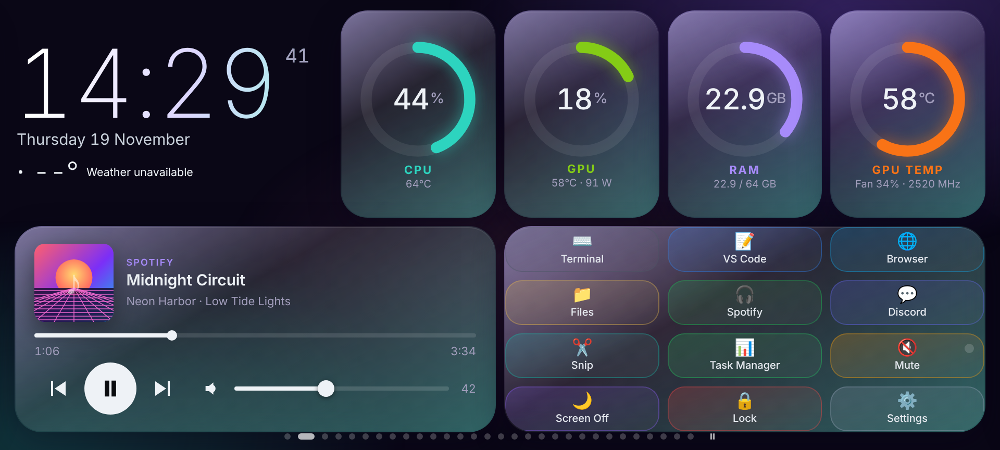</p>

## On a real PC

Not mock-ups: DeskDeck running on a Windows laptop with live data.

| Home | System |
|---|---|
| 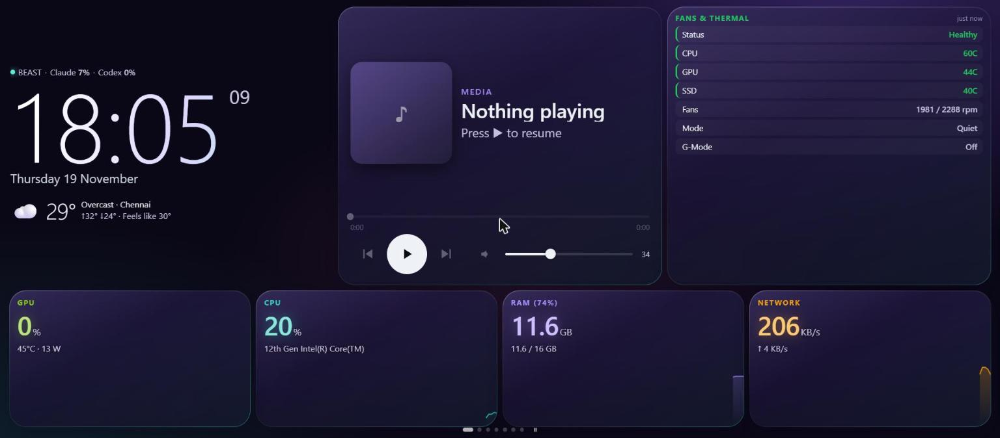 | 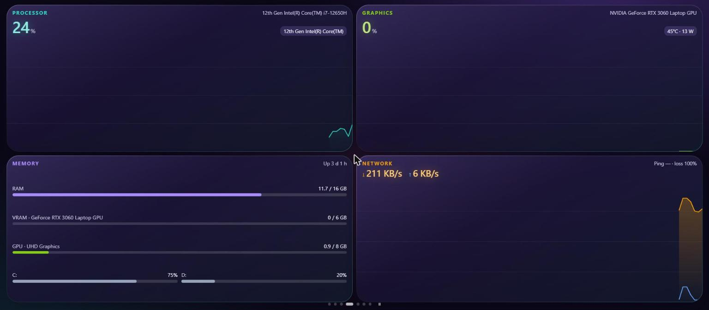 |

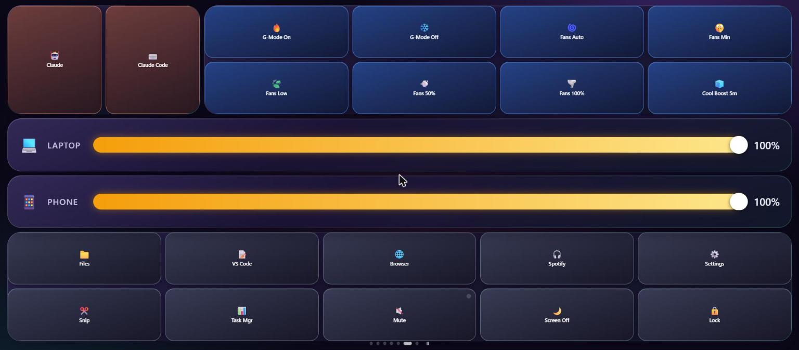

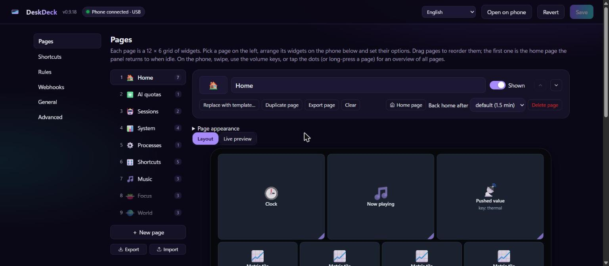

## Why you might want one

| | |
|---|---|
| **Watch your machine** | CPU, GPU, RAM, disks, network, ping, temperatures, fans, charts and a process list |
| **Keep an eye on AI coding** | Claude, Codex and Antigravity quotas with burn-rate forecasts, live Claude Code and Codex sessions, GitHub reviews and CI. Answer Claude Code's permission prompts with **Allow** or **Deny** from the phone |
| **Tap instead of alt-tab** | Launch apps and URLs, send key combos and macros, change volume, mic, brightness, OBS scenes and tasks through [Control Deck](docs/CONTROL-DECK.md) |
| **Everyday glanceables** | Now Playing, internet radio, clocks, weather, calendars, notes, checklists, timers |
| **Automate** | Push values and notifications with one `curl`, drive Home Assistant, and let rules switch pages when a call or a waiting AI session needs you |

## Get started

You need an **Android 7+ phone** and a computer. Release agents bundle .NET, so there is nothing else to install.

**1. Install the desktop agent**

Windows 10/11 (normal PowerShell window):

```powershell
irm https://raw.githubusercontent.com/AnirudhKaplish/deskdeck/main/setup.ps1 | iex
```

Linux or macOS:

```sh
curl -fsSL https://raw.githubusercontent.com/AnirudhKaplish/deskdeck/main/setup.sh | bash
```

Setup downloads the latest release, verifies its SHA-256 checksum, offers start-at-login, installs the phone app over
USB if you like, and opens the editor at <http://127.0.0.1:8765>. Run it again any time to update or repair; your
settings and pairings stay. Read the scripts first if you prefer: [setup.ps1](setup.ps1) · [setup.sh](setup.sh).

> Windows builds are unsigned for now, so SmartScreen or antivirus may complain. See the
> [code signing policy](#code-signing-policy) and [install warnings](docs/SETUP.md#quick-start).

**2. Connect the phone**

| Over USB | Over Wi-Fi only |
|---|---|
| Turn on **Developer options → USB debugging**, plug in a data cable, accept the prompt. Setup (or **Settings → General → Install the phone app**) installs the app and the panel opens by itself. | Install the APK from the [latest release](https://github.com/AnirudhKaplish/deskdeck/releases/latest). In **Settings → General** enable **Wi-Fi & Tailscale**, restart the agent, choose **Pair a phone over Wi-Fi**, scan the QR code and confirm the check code. |

Connect over USB once with Wi-Fi enabled and DeskDeck falls back between the two automatically.
[Connection details and Tailscale →](docs/SETUP.md#wi-fi--tailscale)

**3. Make it yours**

Open <http://127.0.0.1:8765> (or double-click the tray icon on Windows), pick a template under **Pages**, drag and
resize widgets, press **Save**. Swipe, tap the page dots or use the volume keys on the phone to move around.

<details>
<summary><b>Other ways to install</b></summary>

- **Manual:** unzip the agent for your system from the [releases](https://github.com/AnirudhKaplish/deskdeck/releases/latest) and run it; install the APK on the phone. Checksums come with every release.
- **Scoop (Windows):**

  ```powershell
  scoop bucket add deskdeck https://github.com/AnirudhKaplish/deskdeck
  scoop install main/adb deskdeck/deskdeck
  ```

- **From source:** see the [install guide](docs/SETUP.md#other-ways-to-install) and the [development guide](docs/DEVELOPMENT.md).

</details>

## The editor

<p align="center">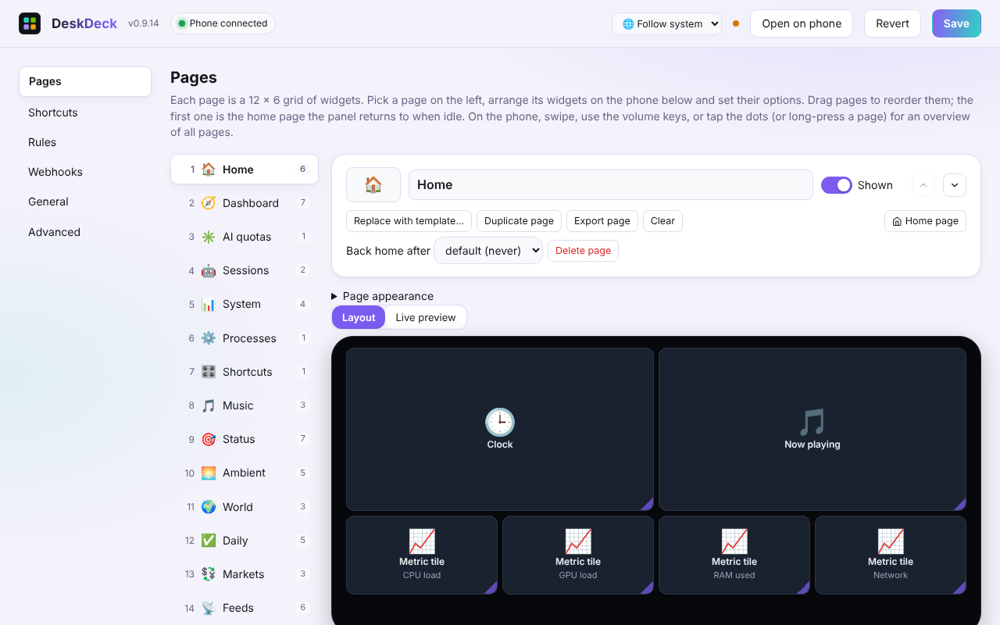</p>

Every page is a 12 × 6 grid, portrait or landscape. Smart Stack packs up to 12 widgets into one slot. Fonts, sizes,
spacing, corners and surfaces can be changed globally, per page or per widget: see the [appearance guide](docs/APPEARANCE.md).
Prefer another mood? Settings also offers AMOLED black, Midnight, Warm and Graphite themes.

More pages, with demo data:

| Home | AI sessions |
|---|---|
| 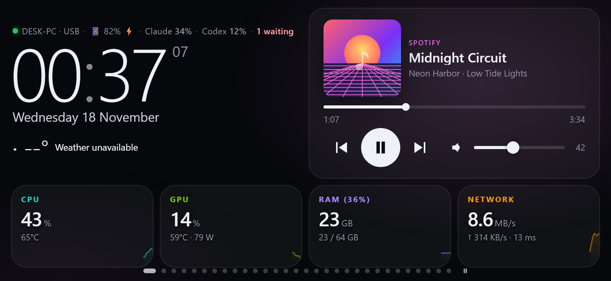 | 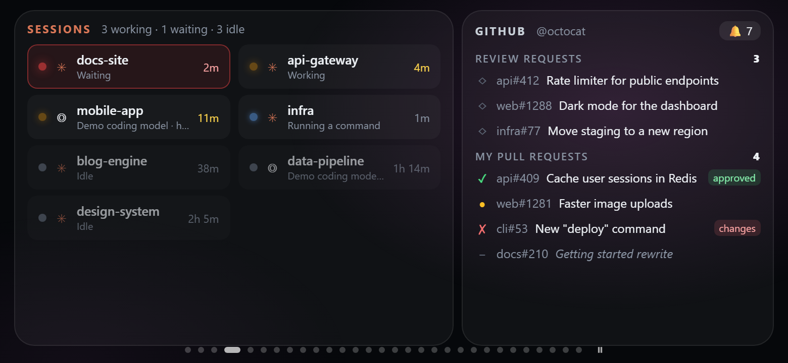 |
| **System** | **Control Deck** |
| 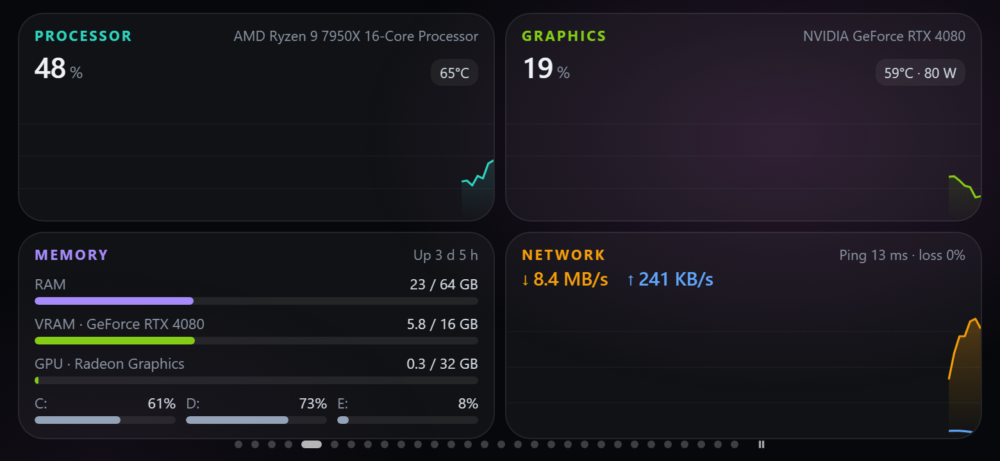 | 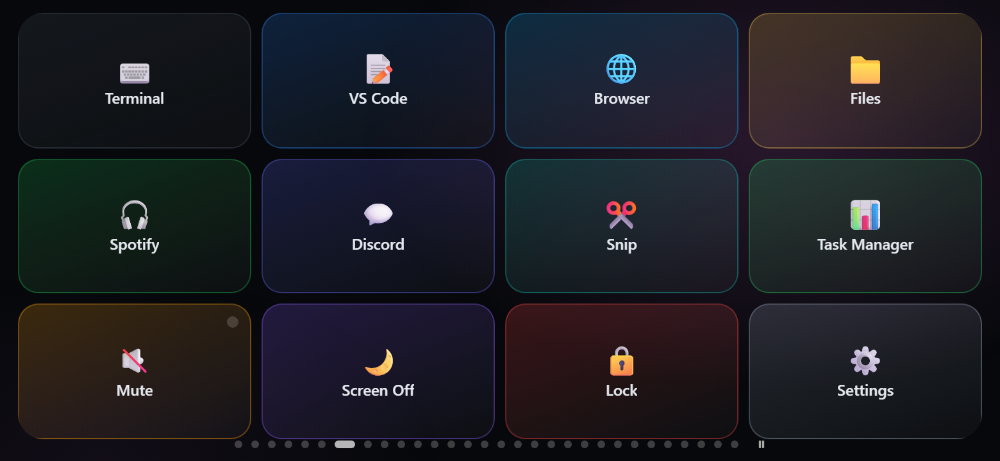 |

## What runs where

| | Windows | Linux | macOS |
|---|---|---|---|
| Builds | x64 | x64 / ARM64 (glibc) | Apple silicon / Intel |
| CPU, RAM, disks, network, processes | ✓ | ✓ | ✓ |
| GPU | Windows counters, NVIDIA via `nvidia-smi`, more via [LibreHardwareMonitor](docs/SETUP.md#librehardwaremonitor-on-windows) | NVIDIA / AMD, Intel clock | Apple silicon when macOS exposes it |
| Media | System media sessions | `playerctl` | `nowplaying-cli`, Spotify / Music fallback |
| Volume | Native | `wpctl` / `pactl` | System output (varies by device) |
| Agent UI | Tray icon + browser | Browser | Browser |

Widgets depend on your hardware, installed tools and permissions. Windows ARM and musl Linux (Alpine) have no builds.
The [full compatibility table](docs/SETUP.md#what-works-where) has the details.

## Docs

| Guide | What is in it |
|---|---|
| [Install & connect](docs/SETUP.md) | Options, warnings, USB, Wi-Fi, Tailscale, updates, uninstall, troubleshooting |
| [User guide](docs/GUIDE.md) | Template gallery, widgets, AI integrations, Claude Code prompts, webhooks, rules |
| [Appearance](docs/APPEARANCE.md) | Fonts, surfaces, presets, inheritance |
| [Control Deck](docs/CONTROL-DECK.md) | Audio, media, OBS, shortcuts, tasks, platform limits |
| [Discord widget](docs/DISCORD.md) | Connecting a Discord application |
| [Development](docs/DEVELOPMENT.md) | Architecture, local demo, builds, tests |
| [Contributing](CONTRIBUTING.md) · [Changelog](CHANGELOG.md) · [Releasing](docs/RELEASING.md) | For contributors and maintainers |

The [UMIDIGI BISON extras](extras/umidigi-bison) hold a reversible, no-root tune-up for one phone.

## Privacy and security

The editor listens on `127.0.0.1:8765` only; USB reaches it through `adb reverse`. Optional Wi-Fi uses HTTPS on port
8766 with a pinned certificate and a paired key. The phone asks for actions by ID, so commands and credentials never
leave the computer.

DeskDeck has no telemetry, analytics or accounts. Optional widgets contact services for weather, quotas and GitHub data,
and the agent checks GitHub for updates. [PRIVACY.md](PRIVACY.md) lists every outbound connection and how to switch
it off. Found a vulnerability? See [SECURITY.md](SECURITY.md).

## Build it yourself

The agent is **.NET 10**; the app is **Kotlin + a WebView** running plain-JavaScript widgets (JDK 17, Android SDK 35;
the app runs on Android 7+). Try the panel and editor with simulated data:

```sh
python tools/demo-server.py
```

Then open <http://127.0.0.1:8790/panel/> or <http://127.0.0.1:8790/settings/>.
[Development commands →](docs/DEVELOPMENT.md#development) · [Contributing →](CONTRIBUTING.md)

## Code signing policy

- **Windows agent:** unsigned for now. Each release ships SHA-256 checksums and a build-provenance attestation. Bundled runtime and library notices: [THIRD-PARTY-NOTICES.txt](agent/DeskDeck.Agent/THIRD-PARTY-NOTICES.txt).
- **Android app:** release APKs are signed with the project's own key.
- **Maintainer:** [AnirudhKaplish](https://github.com/AnirudhKaplish).

## Credits and license

DeskDeck started from the MIT-licensed open-source project PhoneBox and has since been restyled and extended
(Aurora glass look, new icon, Wi-Fi pairing page, setup fixes). The original copyright notice stays in [LICENSE](LICENSE),
as the MIT license requires. DeskDeck is released under the [MIT license](LICENSE).

If it earns a place on your desk, a ⭐ on GitHub helps others find it.

<a href="https://www.star-history.com/#AnirudhKaplish/deskdeck&Date">
  <picture>
    <source media="(prefers-color-scheme: dark)" srcset="https://api.star-history.com/svg?repos=AnirudhKaplish/deskdeck&type=Date&theme=dark">
    
  </picture>
</a>
